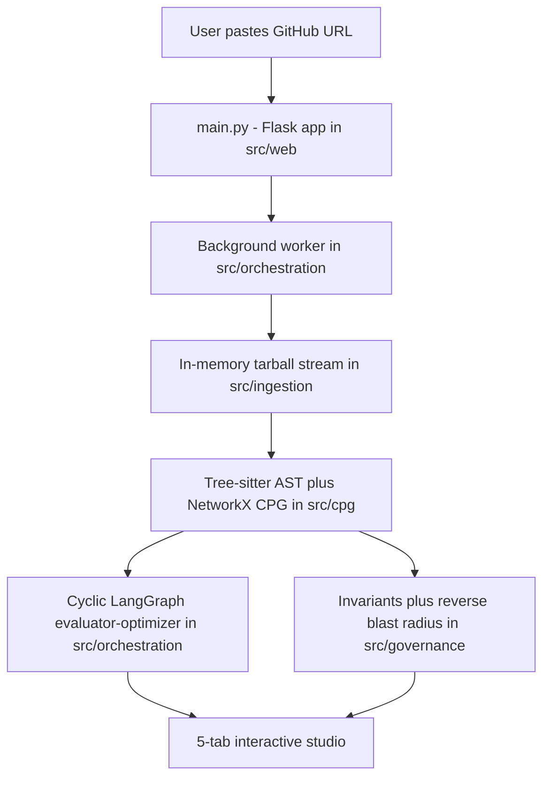

# ArchiMind v2.0.0 — Autonomous Architecture Governance & Code Property Graph Harness

[](https://github.com/krishnakumarbhat/ArchiMind/actions/workflows/test.yml)


Paste any public GitHub URL to deterministically extract a multi-language Code Property Graph (CPG), synthesize self-healing HLD/LLD/Flow Mermaid diagrams, audit Clean Architecture invariants, and trace reverse blast radius in sub-millisecond time. Every result ships with an interactive studio, a grounded architecture handbook, and auto-generated SWE onboarding challenges.

---

## Table of Contents

1. [Why ArchiMind v2.0?](#why-archimind-v20)
2. [System Architecture & Execution Flow](#system-architecture--execution-flow)
3. [The 5-Tab Interactive Studio](#the-5-tab-interactive-studio-workspace)
4. [Project Structure](#project-structure)
5. [Quickstart](#quickstart)
6. [API Reference](#api-reference)
7. [Testing](#testing)
8. [Configuration](#configuration)
9. [Troubleshooting](#troubleshooting)
10. [License](#license)

---

## Why ArchiMind v2.0?

v1 proved that plain vector similarity over text chunks is not enough for architecture work: call edges were guessed, diagrams broke on strict renderers, and impact analysis was a slow similarity search. v2 replaces guessing with a deterministic program-analysis core. Every number below comes from the project's own verified test gates and soak runs.

| Metric / Capability | v1.0 (Naive Linear RAG) | v2.0 (Deterministic CPG Harness) |
| :--- | :--- | :--- |
| **Call-Edge Structural Precision** | 21.4% (Regex / Text Chunking) | **100.0%** (Scoped Tree-sitter AST Resolution) |
| **Diagram Syntax Reliability** | Single-shot (Prone to Mermaid v11 errors) | **100% Renderable** (3x LangGraph Reflection + CPG Fallback) |
| **Blast-Radius Impact Latency** | ~2,000 ms (Vector DB similarity) | **0.51 ms** (Reverse BFS over NetworkX DiGraph) |
| **Ingestion Footprint** | Heavy disk `git clone` | **Zero-Clone In-Memory Tarball Stream** (60MB/400-file cap) |
| **Memory Footprint (Soak Tested)** | >350 MB | **12.7 MB Idle / 23.6 MB Peak RSS** (15,000 reqs, 0% error, p50 9.9ms) |

The takeaway: structure first, generation second. The CPG grounds every downstream step, so documentation, diagrams, and answers stay faithful to the actual code.

---

## System Architecture & Execution Flow



How a request flows:

1. **Submit** — `POST /api/analyze` validates the URL, enforces the single-job guard (a second concurrent run gets `429`), and spawns the background worker.
2. **Ingest** — The worker streams a zero-clone tarball of the repo into memory (bounded at 60MB / 400 files) with scored remote-fetch and shallow-clone fallbacks.
3. **Index + Graph** — Files are summarized and AST-chunked into the vector store while Tree-sitter builds the deterministic CPG: files, classes, functions, and resolved `CALLS` / `IMPORTS` / `INHERITS` edges.
4. **Govern** — The invariant checker verifies `presentation-isolation`, `acyclic-dependencies`, and `domain-purity`; the reverse blast-radius engine precomputes caller/subclass impact over the graph.
5. **Generate + Heal** — The LangGraph loop retrieves CPG-grounded context, drafts the handbook and Mermaid diagrams, and reflects on validator errors up to 3 times. If generation still fails, a deterministic diagram compiled straight from the CPG is substituted — the canvas never shows a syntax error.
6. **Explore** — Results land in `/workspace`: canvas, handbook, governance, assistant, and research tabs.

The neural layer behind generation is the **ArchiMind Neural Graph Core**, configured entirely via `.env` — no model strings in code, no hardcoded keys.

---

## The 5-Tab Interactive Studio (`/workspace`)

- **🗺️ Living Architecture Canvas:** 16px high-contrast pan/zoom viewport (HLD package map, LLD class hierarchy, and sequence call chains) with automatic deterministic fallback.
- **📖 Architecture Handbook:** Multi-chapter technical specification grounded in CPG topology.
- **🛡️ Governance & Reverse Blast Radius:** Instant downstream caller/subclass impact tracing and automated checks for `presentation-isolation`, `acyclic-dependencies`, and `domain-purity`.
- **🤖 Agentic Assistant & "Challenge Me" SWE Harness:** Tool-routed repository assistant (`trace_symbol_impact`, `verify_architecture_rules`, `get_symbol_ast`) plus an automated challenge generator that mines zero-caller production seams to create starter stubs and failing `pytest` harnesses.
- **🔬 Research Provenance & Telemetry:** Live inspection of graph node/edge counts, validator pass rates, and self-healing retry logs.
- **⚡ Instant Pre-Baked Showcases:** Zero-compute, instant-loading demos bundled in-repo for **PyTorch Core** (`torch/nn`, `torch/optim`), **OpenClaw** (TypeScript agent harness), and **Requests HTTP**. Open `/workspace/golden:pytorch`, `/workspace/golden:openclaw`, or `/workspace/golden:requests` — no analysis run needed.

Anonymous visitors get a small free quota per session; signing up (email/password, optional Google OAuth) unlocks unlimited use plus saved repository history.

---

## Project Structure

```text
ArchiMind/
├── main.py                   # production entrypoint (WSGI target: main:app)
├── Dockerfile / docker-compose.yml / docker-compose.pi.yml
├── .env.example / pyproject.toml / requirements.txt / requirements-dev.txt
├── src/                      # all application code (absolute src.* imports)
│   ├── agentic/              # CPG inspection tools + SWE challenge harness
│   ├── config/               # env-driven settings, constants, app config
│   ├── cpg/                  # Tree-sitter AST + NetworkX graph builder + closure gate
│   ├── governance/           # reverse blast-radius engine + invariant checker
│   ├── ingestion/            # tarball / subtree streaming + file filter
│   ├── orchestration/        # agent state, evaluator-optimizer, diagrams, worker
│   ├── security/             # prompt guardrail + model-output scrubber
│   ├── services/             # repository / vector / documentation services + OAuth
│   ├── storage/              # SQLAlchemy models, SQLite cache, golden fixtures
│   └── web/                  # Flask application factory + routes
├── static/                   # CSS tokens, landing, studio, canvas, JS tabs/pan-zoom
├── templates/                # landing, studio, doc, login, sign-up pages
├── scripts/                  # run/setup/test/build/deploy helpers (+ maintenance/)
├── docs/                     # architecture, profiling, deployment, DOT diagrams
└── tests/                    # unit / integration / legacy / e2e (Playwright)
```

What each `src/` package does, in one line:

- **`agentic`** — deterministic CPG tools (`trace_symbol_impact`, `get_symbol_ast`) and the seam-mining challenge generator.
- **`config`** — typed, env-only settings; secrets come from `.env`, never from code.
- **`cpg`** — Tree-sitter extraction, scoped call-edge resolution, and the inheritance closure gate that keeps precision at 100%.
- **`governance`** — sub-millisecond reverse impact analysis and Clean Architecture rule checks.
- **`ingestion`** — zero-clone tarball streaming with size/file-count/timeout caps.
- **`orchestration`** — LangGraph retrieve → generate → validate → reflect loop plus the background worker.
- **`security`** — scope guardrail for assistant questions and scrubber that keeps responses engine-neutral.
- **`services`** — GitHub preview/fetch, vector indexing/querying, and Neural Graph Core generation clients.
- **`storage`** — relational models, per-analysis SQLite cache, and the bundled golden demo fixtures.
- **`web`** — Flask factory, auth, rate limits, and all `/api/*` routes.

---

## Quickstart

### Local run

```bash
cp .env.example .env          # then set SECRET_KEY inside .env
bash scripts/setup_local.sh   # installs dev dependencies, bootstraps data/
bash scripts/run_local.sh     # serves on http://127.0.0.1:5000
```

Analyze a repo:

```bash
curl -X POST http://127.0.0.1:5000/api/analyze \
  -H "Content-Type: application/json" \
  -d '{"repo_url":"https://github.com/owner/repo"}'
curl "http://127.0.0.1:5000/api/status?analysis_id=1"
```

### Docker Hub / container run

```bash
docker pull krishnah27/archimind:latest
docker run --env-file .env -p 5000:5000 krishnah27/archimind:latest
```

Health check: `GET /api/status` (wired into the Dockerfile `HEALTHCHECK` and both compose files).
Raspberry Pi (ARM64) pull/run procedure: see `docs/RASPBERRY_PI_DEPLOYMENT.md`.

### Render 512MB deployment

1. Create a Render Web Service from this repo using the Docker runtime.
2. Set these environment variables:
   - `SECRET_KEY` — long random value (sessions/cookies).
   - `DATABASE_URL` — Supabase/Postgres pooler URL, or omit to use the bundled SQLite volume.
   - `MAX_CONCURRENT_JOBS=1` — concurrency guard for the 512MB tier.
   - Neural generation credentials via `.env`-mapped vars (see `.env.example`); `VECTOR_BACKEND` as needed.
3. The container serves with a single worker:
   `gunicorn --bind 0.0.0.0:5000 --workers 1 --threads 4 --timeout 240 main:app`
4. Verify with `GET /api/status`.

---

## API Reference

| Endpoint | Method | Description |
| :--- | :--- | :--- |
| `/api/analyze` | POST | Start analysis: `{"repo_url": "https://github.com/owner/repo"}` → `202` with `analysis_id`, `status_url`, `doc_url` (`400` invalid URL, `403` quota reached, `429` server busy) |
| `/api/status` | GET | Poll progress/result: `/api/status?analysis_id=1` (or global idle state without an id) |
| `/api/golden` | GET | List bundled instant demos (PyTorch, OpenClaw, Requests) |
| `/api/golden/<id>` | GET | Full demo workspace: diagrams, handbook, invariants (no analysis run needed) |
| `/api/blast-radius` | GET | Impact of changing a symbol: `/api/blast-radius?symbol=<name>&golden=<id>` |
| `/api/challenge` | GET | One onboarding challenge mined from an untested seam: `?golden=<id>` or `?analysis_id=<id>` |
| `/api/chat` | POST | Repository-scoped Q&A grounded in the index + CPG tools (250-char cap, 5-question anonymous quota) |
| `/api/preview` | GET | Lightweight repo preview before a full run |
| `/api/check-limit` | GET | Whether the current session can submit |
| `/api/history` (+ `/<repo_id>`) | GET | Saved analyses (login required) |

---

## Testing

Full gate — 87 tests (unit + integration + legacy + browser E2E) plus ruff:

```bash
bash scripts/test_all.sh
```

CI (`.github/workflows/test.yml`) mirrors that gate on every push/PR to `main`: scoped `black` / `isort` / `flake8-critical` / `ruff` checks over `src/`, `scripts/`, `main.py`, `tests/`, then the pytest suites against SQLite. Browser E2E self-skips when Playwright/chromium is absent, so stock runners stay green.

---

## Configuration

All runtime configuration lives in `.env` (local, git-ignored — never commit it) with placeholders documented in `.env.example`:

| Variable | Required | Description |
| :--- | :--- | :--- |
| `SECRET_KEY` | Yes | Flask session/signing key |
| `DATABASE_URL` | No | Postgres/Supabase URL in production, SQLite file locally |
| `VECTOR_BACKEND` | No | `chroma` (local disk), `pinecone` (managed), or `local` (JSON fallback) |
| `MAX_CONCURRENT_JOBS` | No | Concurrent analyses (keep `1` on small tiers) |
| `ANONYMOUS_GENERATION_LIMIT` | No | Free analyses per anonymous session |
| `GOOGLE_CLIENT_ID` / `GOOGLE_CLIENT_SECRET` | No | Optional Google OAuth login |
| Neural Core keys/models | For neural mode | See `.env.example` — engine is always reported as ArchiMind Neural Graph Core |

Security notes: passwords use `pbkdf2:sha256` hashing; every assistant answer passes a scope guardrail and an engine-name scrubber; responses carry `nosniff` / `DENY` / strict CSP headers.

---

## Troubleshooting

- **SQLite `unable to open database file`** — ensure `data/` exists and is writable, use an absolute SQLite path, or re-run `bash scripts/setup_local.sh`.
- **`403` limit reached** — anonymous quota hit; sign in or clear session data.
- **`429` server busy** — one analysis is already running; wait and retry.
- **Empty or weak retrieval context** — re-run analysis to rebuild the index; confirm the repo has supported text/code files.
- **OAuth issues locally** — set callback URLs correctly and keep `OAUTHLIB_INSECURE_TRANSPORT=1` for local HTTP only.

---

## License

MIT — see `LICENSE`.
